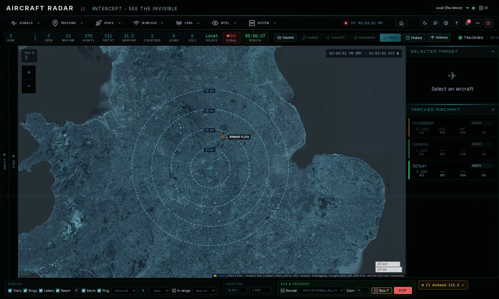

<p align="center">
  
</p>

<p align="center">
  
  
  
</p>

<p align="center">
Support the developer of this open-source project
</p>

<p align="center">
  <a href="https://www.buymeacoffee.com/smittix" target="_blank"></a>
</p>
<p align="center">
  <strong>Signal Intelligence Platform</strong><br>
  A web-based interface for software-defined radio tools.
</p>

<p align="center">
  
</p>

---

## Features

Text and scan modes run in the main app; map-heavy modes open as full-screen dashboards.

**Signals**
- **Pager**: POCSAG and FLEX via rtl_fm + multimon-ng
- **433MHz sensors**: 200+ device protocols (weather stations, TPMS, IoT) via rtl_433
- **Utility meters**: electric, gas and water meter broadcasts via rtlamr
- **Sub-GHz**: HackRF capture, decode and replay across the 300-928 MHz ISM bands
- **Waterfall**: real-time spectrum waterfall with click-to-tune audio (FM, AM, USB, LSB), bookmarks and handoff to decoders
- **CW/Morse**: Morse decoding by tone (HF) or on-off envelope (ISM)
- **OOK decoder**: raw on-off-keyed frames as bits, hex and ASCII, for reverse-engineering unknown remotes and sensors

**Tracking**
- **Aircraft dashboard**: ADS-B radar map via dump1090/readsb, with ACARS and VDL2 panels, airband audio, "Tune ATC" and optional PostgreSQL history
- **Vessels dashboard**: AIS via AIS-catcher, with VHF DSC distress monitoring
- **APRS dashboard**: amateur packet radio positions and telemetry via direwolf
- **GPS**: live position, speed, altitude and satellites via gpsd
- **Radiosonde**: weather balloon telemetry via radiosonde_auto_rx

**Space**
- **Satellite dashboard**: pass prediction, polar plot and ground track
- **ISS SSTV and HF SSTV**: slow-scan TV images, with Doppler correction for the ISS
- **Weather satellites**: NOAA APT and Meteor LRPT via SatDump, with an auto-scheduler
- **WeFax**: HF weather fax from maritime and aviation stations
- **Meteor scatter**: VHF beacon reflections from meteor trails
- **Space weather**: solar and geomagnetic data from NOAA SWPC, NASA SDO and HamQSL (no SDR needed)

**Wireless**
- **WiFi and Bluetooth**: network and device discovery, tracker detection (AirTag, Tile, SmartTag)
- **WiFi Locate and BT Locate**: find a specific access point or device by signal strength, with a GPS trail

**LoRa**
- **Meshtastic and Meshcore dashboards**: messages, searchable node lists and maps; Meshtastic also keeps message history and can fetch missed messages from a Store & Forward router

**Intel**
- **TSCM and TSCM Survey**: counter-surveillance sweeps against an RF baseline, with a survey workspace and client reports
- **Activity**: one feed of sightings from every mode
- **Drone intelligence**: Remote ID (WiFi/BLE) plus RF detection on 433/868 MHz and 2.4/5.8 GHz
- **Spy stations**: number station and diplomatic HF network database
- **WebSDR**: listen through remote KiwiSDR receivers

**Platform**
- **Message store**: everything the decoders hear in one searchable database (`/messages`), with CSV/JSON export
- **Alerts**: watchlists and alert rules pushed to ntfy, Telegram or any webhook
- **CoT export**: ADS-B, AIS, APRS and Meshtastic positions to ATAK, WinTAK or TAK Server
- **SDR devices**: name each dongle and save its PPM correction, gain and bias-T; use a remote SDR over rtl_tcp
- **User accounts**: sign-in with per-user passwords and a users directory
- **Remote agents**: run sensor nodes elsewhere and control them from one interface
- **Offline mode**: bundled assets for air-gapped and field use

---

## Installation / Debian / Ubuntu / macOS

### Quick Start

```bash
git clone https://github.com/smittix/intercept.git
cd intercept
./setup.sh          # Interactive menu (first run launches setup wizard)
sudo ./start.sh
```

On first run, `setup.sh` launches a **guided wizard** that detects your OS, lets you choose install profiles, sets up the Python environment, and optionally configures environment variables and PostgreSQL.

On subsequent runs, it opens an **interactive menu**:

```
INTERCEPT Setup Menu
════════════════════════════════════════
  1) Install / Add Modules
  2) System Health Check
  3) Database Setup (ADS-B History)
  4) Update Tools
  5) Environment Configurator
  6) Uninstall / Cleanup
  7) View Status
  0) Exit
```

> **Production vs Dev server:** `start.sh` auto-detects gunicorn + gevent and runs a production server with cooperative greenlets — handles multiple SSE/WebSocket clients without blocking. Falls back to Flask dev server if gunicorn is not installed. For quick local development, you can still use `sudo -E venv/bin/python intercept.py` directly.

### Install Profiles

Choose what to install during the wizard or via menu option 1:

| # | Profile | Tools |
|---|---------|-------|
| 1 | Core SIGINT | rtl_sdr (with RTL-SDR Blog V4 drivers), multimon-ng, rtl_433, dump1090, acarsdec, dumpvdl2, rtlamr, ffmpeg, gpsd |
| 2 | Maritime & Radio | AIS-catcher, direwolf |
| 3 | Weather & Space | SatDump, radiosonde_auto_rx |
| 4 | RF Security | aircrack-ng, HackRF, BlueZ, hcxtools, Ubertooth, SoapySDR |
| 5 | Full SIGINT | All of the above |
| 6 | Custom | Per-tool checklist |

Multiple profiles can be combined (e.g. enter `1 3` for Core + Weather).

### CLI Flags

```bash
./setup.sh --non-interactive          # Headless full install (same as legacy behavior)
./setup.sh --profile=core,weather     # Install specific profiles
./setup.sh --health-check             # Check system health and exit
./setup.sh --postgres-setup           # Run PostgreSQL setup and exit
./setup.sh --menu                     # Force interactive menu
```

### Docker

```bash
git clone https://github.com/smittix/intercept.git
cd intercept
docker compose --profile basic up -d --build
```

> **Note:** Docker requires privileged mode for USB SDR access. SDR devices are passed through via `/dev/bus/usb`.

> **Your data:** settings, users, alert rules, watchlists and decoded messages live in `./instance` on the host, so they survive `--build`. Upgrading from a compose file without that mount? Copy the old data out before rebuilding: `docker cp intercept:/app/instance ./instance`.

For multi-architecture builds (amd64 + arm64 for Raspberry Pi), see `build-multiarch.sh` — it handles cross-compilation and registry push in one step.

### Environment Configuration

Use the **Environment Configurator** (menu option 5) to interactively set any `INTERCEPT_*` variable. Settings are saved to a `.env` file that `start.sh` sources automatically on startup.

You can also create or edit `.env` manually:

```bash
# .env (auto-loaded by start.sh)
INTERCEPT_PORT=5050
INTERCEPT_ADSB_AUTO_START=true
INTERCEPT_DEFAULT_LAT=51.5074
INTERCEPT_DEFAULT_LON=-0.1278
```

### ADS-B History (Optional)

The ADS-B history feature persists aircraft messages to PostgreSQL for long-term analysis.

**Automated setup (local install):**

```bash
./setup.sh --postgres-setup
# Or use menu option 3: Database Setup
```

This will install PostgreSQL if needed, create the database/user/tables, and write the connection settings to `.env`.

**Docker:**

```bash
docker compose --profile history up -d
```

Set the following environment variables (in `.env`):

```bash
INTERCEPT_ADSB_HISTORY_ENABLED=true
INTERCEPT_ADSB_DB_HOST=adsb_db
INTERCEPT_ADSB_DB_PORT=5432
INTERCEPT_ADSB_DB_NAME=intercept_adsb
INTERCEPT_ADSB_DB_USER=intercept
INTERCEPT_ADSB_DB_PASSWORD=intercept
```

To store Postgres data on external storage, set `PGDATA_PATH` (defaults to `./pgdata`):

```bash
PGDATA_PATH=/mnt/usbpi1/intercept/pgdata
```

Then open **/adsb/history** for the reporting dashboard.

### System Health Check

Verify your installation is complete and working:

```bash
./setup.sh --health-check
# Or use menu option 2
```

Checks installed tools, SDR devices, port availability, permissions, Python venv, `.env` configuration, and PostgreSQL connectivity.

### Open the Interface

After starting, open **http://localhost:5050** in your browser.

**There is no default password.** On first start, INTERCEPT generates one for the `admin` account, logs it, and writes it to `instance/.initial_password`. Log in with that, and you will be asked to set your own before the interface unlocks.

To choose your own up front, set `INTERCEPT_ADMIN_PASSWORD` before first start. See [Security](docs/SECURITY.md#authentication) for details and for why this replaced the previous `admin`/`admin` default.

---

## Hardware Requirements

| Hardware | Purpose | Price |
|----------|---------|-------|
| **RTL-SDR** | Required for all SDR features | ~$25-35 |
| **WiFi adapter** | Must support promiscuous (monitor) mode | ~$20-40 |
| **Bluetooth adapter** | Device scanning (usually built-in) | - |
| **GPS** | Any gpsd-supported GPS receiver | ~$10 |

Most features work with a basic RTL-SDR dongle (RTL2832U + R820T2).

| :exclamation:  Not using an RTL-SDR Device?   |
|-----------------------------------------------
|Intercept supports any device that SoapySDR supports. You must however have the correct module for your device installed! For example if you have an SDRPlay device you'd need to install soapysdr-module-sdrplay.

| :exclamation:  GPS Usage   |
|-----------------------------------------------
|gpsd is needed for real time location. Intercept automatically checks to see if you're running gpsd in the background when any maps are rendered.

---

## Discord Server

<p align="center">
  <a href="https://discord.gg/EyeksEJmWE">Join our Discord</a>
</p>


---

## Documentation

- [Features](docs/FEATURES.md) - Every mode at a glance, with what it needs
- [Usage Guide](docs/USAGE.md) - How to use each mode
- [Hardware Guide](docs/HARDWARE.md) - SDR hardware, manual install, multiple dongles
- [Troubleshooting](docs/TROUBLESHOOTING.md) - Common issues and solutions
- [Webhooks and Alerts](docs/WEBHOOKS.md) - Watchlists, alert rules and push notifications
- [Distributed Agents](docs/DISTRIBUTED_AGENTS.md) - Remote sensor node deployment
- [Security](docs/SECURITY.md) - Authentication, network exposure and best practices
- [UI Guide](docs/UI_GUIDE.md) - For contributors: page patterns and design tokens

---

## Disclaimer

This project was developed using AI as a coding partner, combining human direction with AI-assisted implementation. The goal: make Software Defined Radio more accessible by providing a clean, unified interface for common SDR tools.

**This software is for educational and authorized testing purposes only.**

- Only use with proper authorization
- Intercepting communications without consent may be illegal
- You are responsible for compliance with applicable laws

---

## License

Apache 2.0 License - see [LICENSE](LICENSE)

## Author

Created by **smittix** - [GitHub](https://github.com/smittix)

## Acknowledgments

[rtl-sdr](https://osmocom.org/projects/rtl-sdr/wiki) |
[multimon-ng](https://github.com/EliasOenal/multimon-ng) |
[rtl_433](https://github.com/merbanan/rtl_433) |
[dump1090](https://github.com/flightaware/dump1090) |
[AIS-catcher](https://github.com/jvde-github/AIS-catcher) |
[acarsdec](https://github.com/TLeconte/acarsdec) |
[direwolf](https://github.com/wb2osz/direwolf) |
[rtlamr](https://github.com/bemasher/rtlamr) |
[dumpvdl2](https://github.com/szpajder/dumpvdl2) |
[aircrack-ng](https://www.aircrack-ng.org/) |
[Leaflet.js](https://leafletjs.com/) |
[SatDump](https://github.com/SatDump/SatDump) |
[Celestrak](https://celestrak.org/) |
[Priyom.org](https://priyom.org/)


